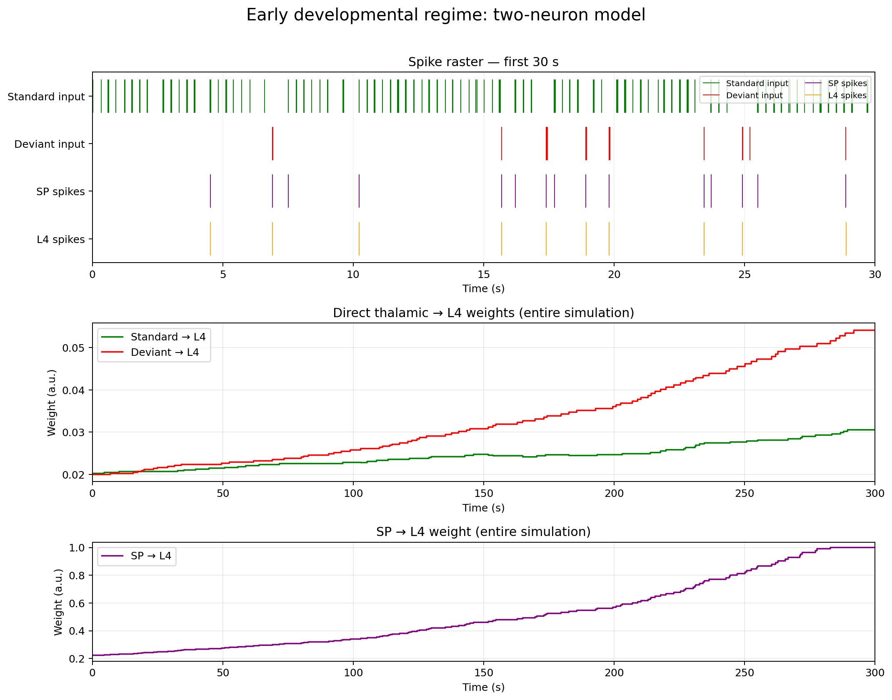
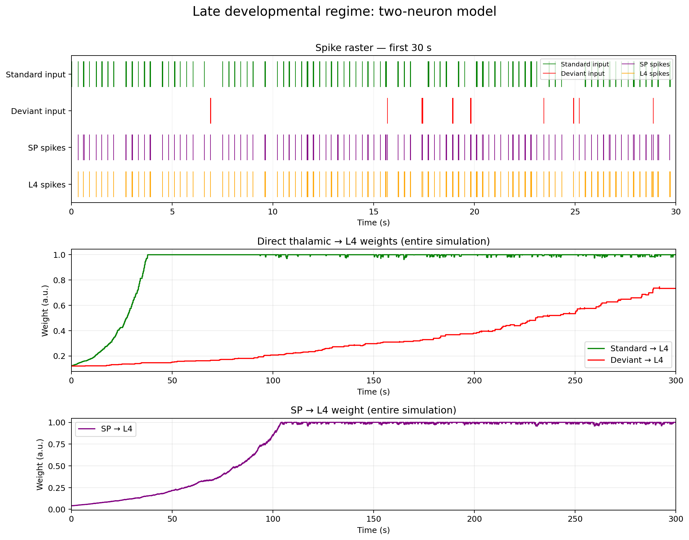

# Two-Neuron Bilayer Model of Developmental Auditory-Cortex Plasticity

An exploratory computational neuroscience project investigating how a simplified **subplate (SP) → layer 4 (L4)** circuit responds to frequently presented *standard* and infrequently presented *deviant* auditory inputs. The model was developed as part of a summer internship and is intended to investigate qualitative consequences of changing synaptic strength and short-term recovery across two developmental parameter regimes.

**Status:** Exploratory numerical model, not an experimentally validated reproduction of auditory-cortex development.

## Research question

How do differences in initial thalamic and subplate connectivity, neuronal excitability, and short-term synaptic-resource recovery affect the spike activity and plasticity of a simplified auditory-cortical circuit before and after ear-canal opening?

Rather than fitting experimental recordings, the notebook uses **synthetically generated stochastic thalamic inputs** and compares the evolution of a small circuit under two hand-selected parameter sets.

## Circuit architecture

The simulation has **two explicitly modelled spiking neurons**—one SP neuron and one L4 neuron—driven by two external thalamic input channels:

```text
Standard thalamic input ──┬──> SP neuron ───> L4 neuron
                          └────────────────> L4 neuron
Deviant thalamic input ───┬──> SP neuron
                          └────────────────> L4 neuron
```

The thalamic → SP connection is fixed in this implementation. Three connections to L4 are plastic: **standard → L4**, **deviant → L4**, and **SP → L4**. The SP and L4 neurons use discrete leaky integrate-and-fire (LIF) dynamics.

## Methods and implementation

### 1. Stochastic standard/deviant input

Each stimulus token spans **300 ms**: a 50-ms active window followed by 250 ms of low-rate background activity. Tokens are independently selected with probabilities **0.90 for standard** and **0.10 for deviant**. The active input channel has a 50-Hz spike probability, while the non-active channel has a 0.15-Hz probability; both have 0.1-Hz background activity between stimulus windows. Spikes are generated by independent Bernoulli draws at **1-ms time steps**.

The 50-Hz active rate was increased from 8 Hz during exploratory parameter tuning to elicit more visible activity; it should not be understood as a measured auditory firing rate.

To convert a binary input train into an exponentially decaying drive, the notebook convolves it with a synaptic kernel (time in ms):

```math
g[k] = \sum_{j=0}^{99} s[k-j]\,e^{-j/10},
```

where `s` denotes the binary presynaptic spike train, with samples outside the recorded interval treated as zero. Thus the kernel has a **10-ms decay constant** and is truncated at 100 ms.

### 2. Leaky integrate-and-fire neurons

Outside the refractory period, both neuron states are updated in discrete time according to

```math
v_{k+1} = 0.9v_k + I_k.
```

When `v` crosses its threshold, a spike is recorded and the state is reset. The model imposes a **20-ms refractory window** with a prescribed exponential recovery trajectory. Voltages, currents, synaptic amplitudes and weights use **abstract model units**, not experimentally calibrated electrical units.

### 3. Short-term synaptic depression

The notebook implements a discrete, three-state synaptic-resource model inspired by the **Tsodyks–Markram** framework. Each relevant pathway maintains available/recovered (`r`), effective (`e`) and inactive (`i`) fractions. For an incoming binary spike `s_k`, the resource flows are

```math
\begin{aligned}
F_{r\to e} &= s_k\min(r_k/\tau_{re},\,r_k), \\
F_{e\to i} &= e_k/\tau_{ei}, \\
F_{i\to r} &= i_k/\tau_{ir}, \\
r_{k+1} &= r_k + F_{i\to r} - F_{r\to e}, \\
e_{k+1} &= e_k + F_{r\to e} - F_{e\to i}, \\
i_{k+1} &= i_k + F_{e\to i} - F_{i\to r}.
\end{aligned}
```

The effective resource fraction modulates the synaptic contribution to the neuron. Different inactive-to-recovered times `τ_ir` are used for early and late regimes.

### 4. Spike-timing-dependent plasticity (STDP)

The three pathways targeting L4 undergo pairwise, multiplicative weight changes. Recent pre/post spike events within a **100-ms window** are paired according to temporal order:

```math
\Delta w =
\begin{cases}
+w A_+\exp[-(t_{post}-t_{pre})/\tau_+], & t_{post}\ge t_{pre},\\
-w A_-\exp[-(t_{pre}-t_{post})/\tau_-], & t_{post}<t_{pre}.
\end{cases}
```

The notebook uses `A₊ = 0.015`, `τ₊ = 13 ms`, `A₋ = 0.021`, and `τ₋ = 20 ms`. It stores recent eligible events rather than summing over all possible spike pairs. Every plastic weight is constrained to **[0, 1]** to avoid unbounded numerical growth. These bounds are a modelling choice, not a biological measurement.

### 5. Developmental parameter regimes

| Model parameter | Early (before ear-canal opening) | Late (after ear-canal opening) |
|---|---:|---:|
| SP spike threshold | 0.10 | 0.15 |
| L4 spike threshold | 0.15 | 0.15 |
| Initial standard → L4 weight | 0.02 | 0.12 |
| Initial deviant → L4 weight | 0.02 | 0.12 |
| Initial SP → L4 weight | 0.22 | 0.04 |
| Fixed thalamic → SP weight | 0.20 | 0.20 |
| Inactive → recovered resource time `τ_ir` | 4,200 ms | 100 ms |

The same recovery-time setting is used for thalamic and SP resource pools within each regime. **These regime parameters were selected during exploratory tuning; they were not estimated independently from experimental developmental recordings.**

## Reproducible simulation and figures

The notebook draws **1,000 tokens** using `RNG_SEED = 2026`, giving a **300-second** simulation. It generates the thalamic spike trains **once**, then runs the early and late conditions with **the same input sequence** but independently initialised neuron and synapse states. This controls for input-sequence differences in the paired comparison.

The outputs include spike times, plastic synaptic-weight trajectories, and numerical sanity checks. The final cells save the following two plots with `plt.savefig()`:

### Early developmental regime



### Late developmental regime



**Reading the figures:** Each image shows a spike raster from the **first 30 seconds** and synaptic-weight histories covering the **entire 300-second simulation**. The first two weight curves represent the direct standard/deviant → L4 connections; the third is the SP → L4 connection.

### Observations from the documented seeded run

| Final weight (model units) | Early | Late |
|---|---:|---:|
| Standard → L4 | 0.03056 | 1.00000 |
| Deviant → L4 | 0.05410 | 0.73360 |
| SP → L4 | 1.00000 | 1.00000 |
| SP spike count | 152 | 1,288 |
| L4 spike count | 126 | 2,060 |

In this **single parameterised run**, the early regime ends with the deviant → L4 weight larger than the standard → L4 weight. The late regime ends with the standard → L4 weight larger than the deviant → L4 weight. Both SP → L4 weights—and the late standard → L4 weight—reach the imposed upper bound of 1.0.

These are descriptive outcomes **of this implementation and seed**, not evidence of a robust population effect or a validated biological mechanism.

## Contents

```text
Bilayer Model/
├── README.md
├── Two_Neuron_Auditory_Cortex_Model.ipynb
├── Early_Regime.png
└── Late_Regime.png
```

- **`Two_Neuron_Auditory_Cortex_Model.ipynb`** — model assumptions, input generation, LIF neuron and synaptic-plasticity functions, simulations of both regimes, checks, and plot export.
- **`Early_Regime.png`** — the saved early-regime simulation figure.
- **`Late_Regime.png`** — the saved late-regime simulation figure.

## Run locally

Requires **Python 3**, **NumPy**, **Matplotlib**, and **Jupyter Notebook or JupyterLab**. No JAX, SciPy, GPU, or external experimental dataset is required for this notebook.

```bash
python -m venv .venv
source .venv/bin/activate  # Linux / macOS
python -m pip install numpy matplotlib jupyterlab
jupyter lab
```

Open `Two_Neuron_Auditory_Cortex_Model.ipynb` and select **Run All**. The default settings produce `Early_Regime.png` and `Late_Regime.png` in the Jupyter working directory. To explore other durations or input sequences, change `NUM_TOKENS` or `RNG_SEED` in the notebook. Longer runs may take substantially more time.

## Scope and limitations

- **Small circuit:** This is a two-neuron model with two external input channels, not a population-scale auditory-cortex network.
- **Exploratory parameters:** Input frequencies, thresholds, initial weights, and recovery times were hand-tuned rather than fitted to measurements.
- **Simplified dynamics:** The LIF recovery rule, resource flow equations, and recent-event STDP implementation are phenomenological approximations.
- **Saturation:** Hard clipping of plastic weights at 1.0 affects the reported trajectories and can obscure differences that a different plasticity rule might show.
- **Single-seed comparison:** A fixed seed improves reproducibility, but does not establish statistical robustness. Multi-seed comparisons, sensitivity analyses, and controlled model ablations would be required before making stronger claims.
- **No biological validation:** The observed early/late differences illustrate behaviour of the chosen computational model; they do not establish a developmental mechanism in living tissue.

This repository component records **completed exploratory simulations** from a broader, not fully completed research project. It is presented to show the model formulation, numerical implementation, parameter choices and limitations rather than as a completed experimental study.
