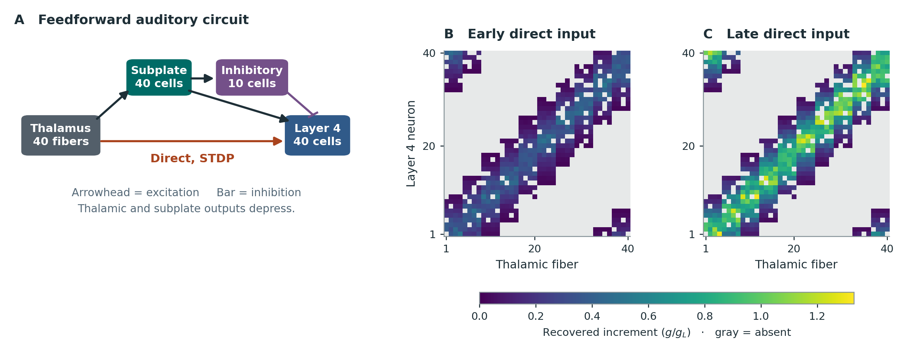
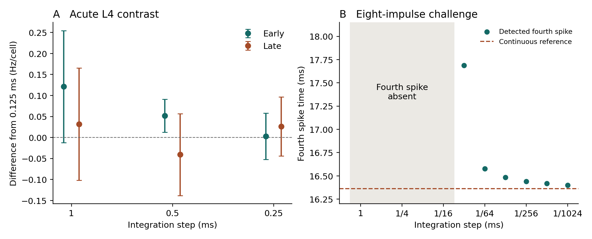
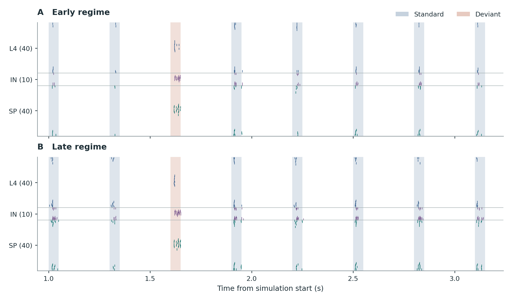
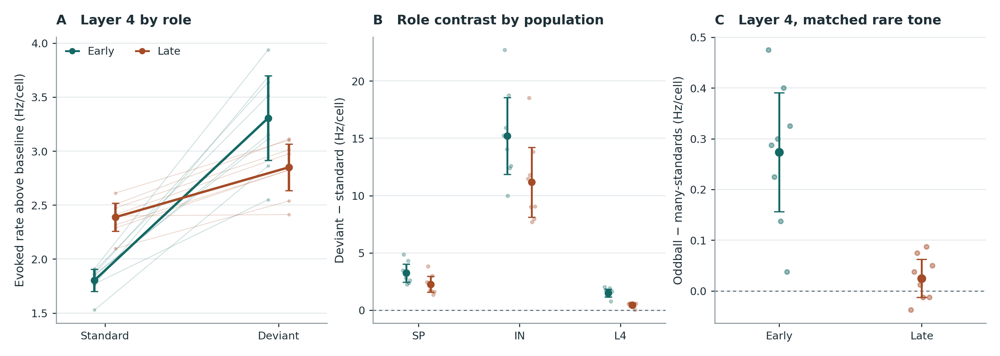
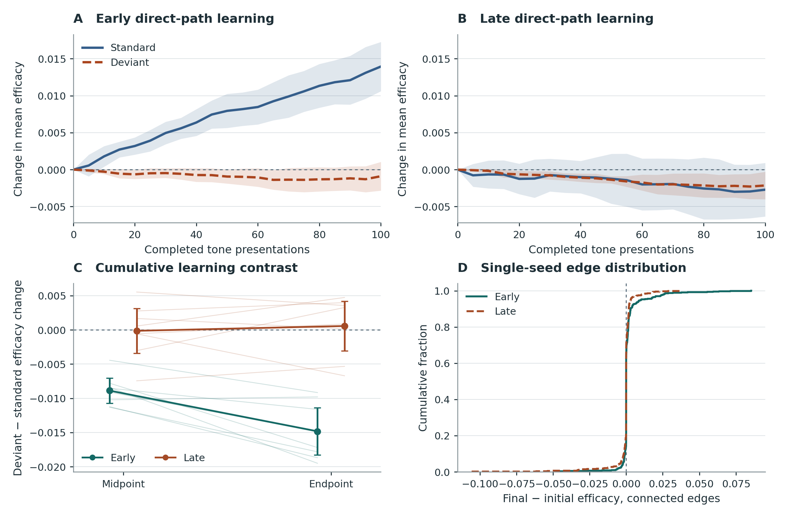
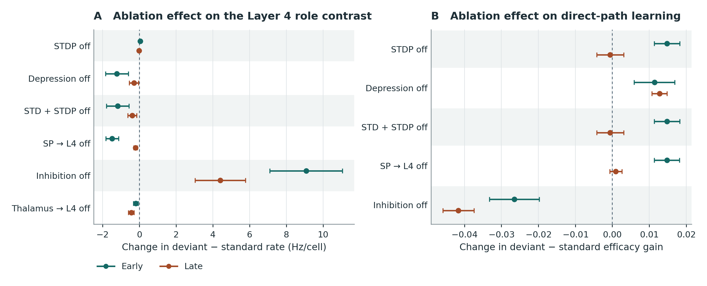
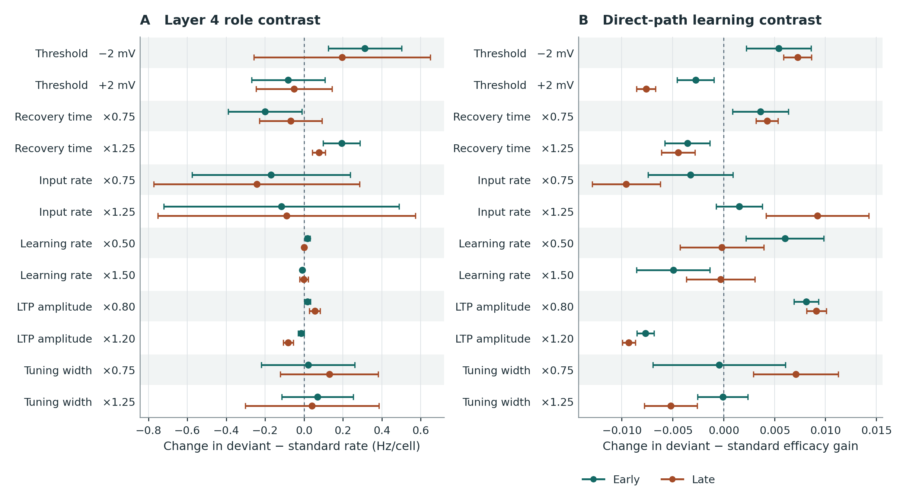
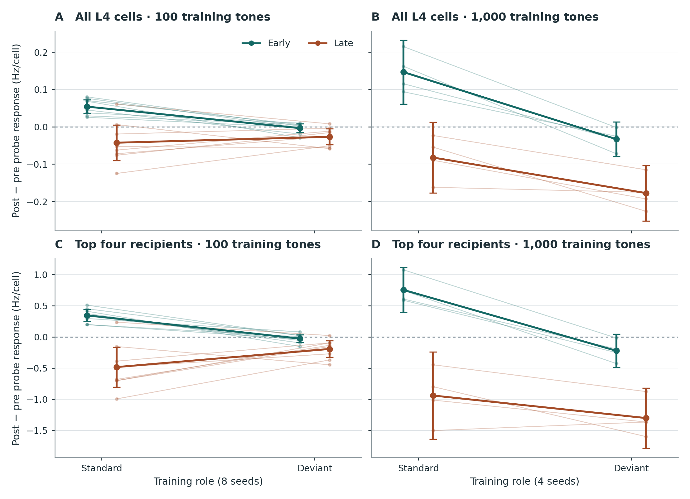
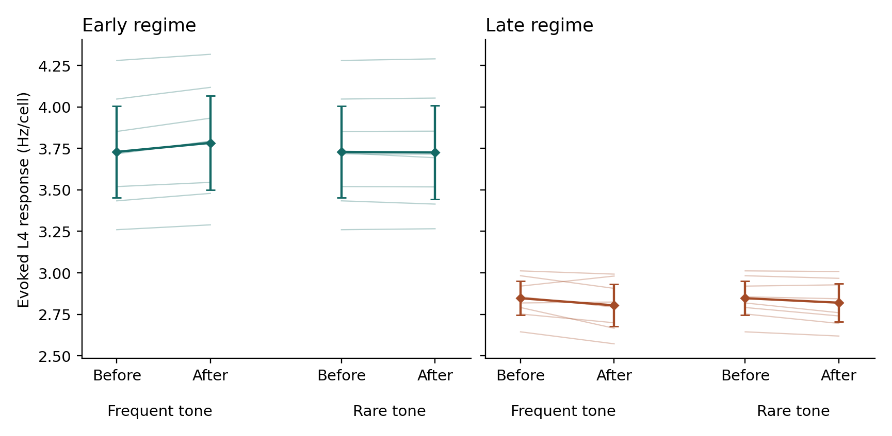

# Developmental auditory plasticity in a feedforward spiking network

## Acute oddball responses, pathway learning and post-exposure readout

**Computational research report · 23 November 2026**

### Abstract

A rare sound can elicit more spikes on each presentation while leaving a weaker trace in a circuit. We tested this possibility in a model of 40 subplate neurons, 10 inhibitory interneurons and 40 layer 4 neurons driven by frequency-tuned thalamic afferents. The model combines a depletable synaptic resource with timing-dependent learning on direct thalamus-to-layer-4 connections. On eight counterbalanced network and input seeds, the rare tone elicited 1.50 Hz/cell more baseline-corrected layer 4 activity than the frequent tone under early parameters and 0.46 Hz/cell more under late parameters. Early direct contacts serving the frequent tone nevertheless strengthened more. Independent single-tone tests, performed after resetting fast states, confirmed an early functional gain favoring the frequent tone at two exposure lengths. Selective depression ablations separated mechanisms for a rare-tone response from those for an effect of surrounding sounds. The proposed developmental reversal in retained tone preference did not emerge under the default parameter sets.

### Scientific motivation

Mehra, Mukesh and Bandyopadhyay measured two outcomes in mice. During exposure, subplate (SP) and layer 4 (L4) differed in their responses to oddball sounds across ear-canal opening. After five days of developmental exposure, adult cortex showed an enhanced representation near the rare exposure frequency for the early window and near the frequent frequency for the later window. Adult evoked firing is a functional endpoint. The synaptic efficacies presented in their paper came from a computational model [1].

Here we ask whether one set of feedforward mechanisms can account jointly for acute selectivity and a retained change in responsiveness. We test the two endpoints separately. Mill and colleagues showed that frequency-tuned depressing synapses can produce oddball effects through stimulus history alone [2]. This makes an independent probe, a control for target probability, and perturbations of the depression mechanism particularly informative.

<!-- report-page -->

## 1. Why the original network needed revision

The internship's vectorised network contained 40 SP cells, 10 interneurons and 40 L4 cells. Two stochastic input trains entered SP with identical weights across the population. SP drove L4 directly and via interneurons. No separate plastic contacts retained the identities of the two thalamic channels after their inputs merged. Even a large final SP-to-L4 weight could therefore carry no uniquely identifiable standard or deviant label.

Outside refractoriness the voltage update was $v_{k+1}=0.9v_k+D_k$ on a fixed 1 ms grid in abstract units. The three-state resource model conserved total fraction. Its forward-Euler spike transfer with a 0.9 ms release constant exhausted the available pool after clipping. A continuous 1 ms release pulse gives about 0.671 of that pool when recovery into it is negligible during the pulse. The product of filtered spikes and active resources also occurs in Mehra's model [1]. Replacing it with release-proportional conductance is a scientific change. The legacy STDP routine labelled all-to-all stored only the last opposite spike and compared right-boundary spike times against a left-boundary update clock. This timing discrepancy is an implementation error.

**Three fresh 105 s replays** found a single identical spike train across all 40 SP cells in every run. Between 82.9% and 86.6% of L4 spikes occurred in 1 ms bins containing all 40 L4 neurons. Between 78.6% and 80.1% of SP-to-L4 weights finished at their upper bound. The historical 24-hour CSV contained 86,400 two-field records beneath a three-field header. Its second column reached $7.79\times10^{46}$. These observations motivated timestep validation, heterogeneous inputs and explicit reports of synchrony and bounds.

### A positive historical result and its dependence on tuning

The revised two-neuron reference reproduced its saved spike counts and weight endpoints. We then crossed active input rate and threshold bundle in 24 replays: three seeds, two stages, two rates and two threshold bundles. The early direct-weight contrast changed sign only under the combined internship adjustments. Each combination gave the indicated sign in all three seeds. Threshold values belong to the earlier abstract model.

| Active rate | Thresholds | Early $\Delta w_D-\Delta w_S$ | Late $\Delta w_D-\Delta w_S$ |
|---:|:---|---:|---:|
| 8 Hz | Published model | −0.221 | −0.747 |
| 8 Hz | Internship | −0.059 | −0.756 |
| 50 Hz | Published model | −0.566 | −0.140 |
| 50 Hz | Internship | +0.026 | −0.190 |

Both direct weights start equal within each age. Every late standard weight hit the upper bound. The archive audit includes per-seed ranges, equations, hashes and replay instructions.

<!-- report-page -->

## 2. Circuit and developmental scenarios

Forty afferents in ten frequency classes drive 90 cortical model neurons. Every cortical cell receives weighted input near its tuning coordinate. Rows of each structural matrix index receiving cells, columns index sources. Gaussian weights are truncated at 2.5 tuning widths, retained with probability 0.85 and scaled by a uniform factor between 0.85 and 1.15. Each row is normalised to its target gain. This controls incoming strength as the number of contacts varies. A nearest contact fills an otherwise empty row. A periodic frequency coordinate makes the paired frequencies equivalent in the ensemble and introduces artificial wraparound at the map boundaries.

**Figure 1. Circuit and initial direct drive.** Thalamus excites both SP and L4. SP excites L4 and a population that inhibits L4. Heatmaps share a seed and show conductance jumps for fully recovered inputs, relative to leak. Gray entries are absent connections. The late direct branch has higher structural gain. In the baseline model, long-term learning occurs on direct thalamus-to-L4 contacts.

| Parameter | Early | Late |
|:---|---:|---:|
| SP to L4 structural row gain | 8.0 | 3.2 |
| Thalamus to L4 structural row gain, before efficacy | 6.4 | 16.0 |
| Thalamic and SP resource recovery time (ms) | 650 | 350 |
| Thalamus to SP / SP to interneurons / interneurons to L4 | 8 / 9 / 5 | 8 / 9 / 5 |

Mouse slice data support an early excitatory thalamus-to-SP-to-L4 relay [3]. Developmental changes in thalamocortical and SP circuits motivate the age interventions [1,4,5]. The numerical strengths are uncalibrated assumptions. Gains and recovery times were piloted for measurable activity. Intrinsic thresholds, inhibitory gain and learning parameters are shared across the two default stages. The original model's 100 and 4,200 ms recovery values are tested separately.

<!-- report-page -->

## 3. Governing equations and integration

**Membrane and transmission.** Synaptic conductances $g_E,g_I$ are measured relative to leak. Each cell obeys

$$\tau_m\dot V=(E_L-V)+g_E(E_E-V)+g_I(E_I-V).$$

Rest and reset are $-65$ mV. Excitatory and inhibitory reversals are 0 and $-80$ mV. SP and L4 have $\tau_m=20$ ms, interneurons 12 ms. Each threshold is drawn independently from a normal distribution with mean $-52$ mV and standard deviation 1 mV. An emitted spike resets the voltage for a 2 ms absolute refractory period. Cortical projections have a 1 ms conduction delay. Excitatory and inhibitory conductances decay with time constants of 5 and 10 ms.

With midpoint conductances fixed over a step $h$, set $g=1+g_E+g_I$ and $V_\infty=(E_L+g_E E_E+g_I E_I)/g$. The solver advances voltage by

$$V_{k+1}=V_\infty+(V_k-V_\infty)\exp(-gh/\tau_m).$$

**Depression.** Between arrivals the available fraction $x$ obeys $\dot x=(1-x)/\tau_\mathrm{rec}$. At a spike, release $Ux^-$ and leave $x^+=(1-U)x^-$ with $U=0.35$. Coincident arrivals release $x^-[1-(1-U)^n]$ for $n$ spikes. Conductance increments are proportional to released resource divided by $U$, preserving the isolated impulse when depression is disabled. Each thalamic afferent and SP neuron has one resource shared by its outputs. Interneuron outputs do not depress. This reduction neglects the finite time resources spend in an active state before recovery [2,6].

**STDP.** For each existing direct contact let $w\in[0,1]$ be dimensionless efficacy, initially uniform on [0.45, 0.55]. Presynaptic and postsynaptic traces $a,b$ sum earlier events, with 20 ms exponential decay. For current counts $n,m$, use the strictly prior decayed traces in

$$w^+=\operatorname{clip}_{[0,1]}\!\left[w+0.004(1-w)am-0.0044\,wbn\right].$$

Current counts enter the traces after this update. An isolated simultaneous pair gives zero change. For distinct times every earlier trace contribution survives with its appropriate decay. Weight dependence and pairing have experimental and theoretical precedents [7,8]. The window, amplitudes and restriction to direct cortical input are assumptions about this circuit.

**Event clock.** Each continuous Poisson arrival is assigned to the first represented grid boundary at or after its timestamp. At that boundary, arrivals use the existing weights, conductances receive released input, and direct STDP combines arriving presynaptic events with simultaneous L4 spikes using old traces. The next membrane interval uses midpoint conductances; threshold crossings are registered at its right boundary. Python generates stimuli and matrices. A bundled double-precision C99 kernel advances the network with event-triggered fan-out. The nominal step is 0.5 ms.

<!-- report-page -->

## 4. Stimuli, experimental controls and estimands

The main screen contained 536 runs and 53,600 tone presentations. Each oddball block had 90 standards and 10 deviants, 50 ms tones, and 300 ms onset spacing after 100 ms of initial background. During each tone four afferents in the matching class each received an independent 50 Hz increment over 0.2 Hz background. Thalamic event times are generated in continuous time. Populations share afferents according to their connectivity.

Each of eight independent seeds (1001–1008) determines a wiring realization, thresholds and input draw. The two physical tones exchange roles in paired runs. Early and late stages use identical physical input events within a role assignment. A ten-tone many-standards stream maintains the target's identity, 10% probability, onset locations, afferent bursts and background while distributing other positions among the nine remaining tones. It changes recent frequency history and the amount of cross-frequency adaptation [2,11,12].

**Response during exposure.** For trial $j$ and population of size $N$, subtract the spike count in the preceding 100 ms from that in the first 100 ms after onset:

$$r_j=\frac{C_j[0,100)-C_j[-100,0)}{N(0.1\ {\rm s})},\qquad R=\bar r_D-\bar r_S.$$

Role means give each presentation of that role equal weight. Rates are in Hz/cell. The descriptive index $I=(\bar r_D-\bar r_S)/(|\bar r_D|+|\bar r_S|)$ is undefined when both rates are zero. The population-level index and time windows differ from single-cell indices in the animal experiments [1].

**Pathway change.** For a physical frequency average $w_{\rm end}-w_0$ over its existing thalamus-to-L4 contacts. The learning contrast is this change for the deviant group minus the same change for the standard group. Efficacy and structural gain are separate factors. Direct-branch deletion makes transmission through these contacts zero and renders their learning contrast physiologically uninterpretable.

**Inference.** Average the two role assignments within each seed, then construct paired differences and two-sided 95% Student-$t$ intervals over seeds. Multiple neurons, events and probe bursts within a circuit inform each seed's estimate. They supply no additional independent realizations. Intervals are pointwise, conditional on the chosen architecture and parameter values.

**Interventions.** The program included disabling each plasticity rule separately and jointly, deleting individual pathways, moderate parameter sweeps, separate depression sites, the historical recovery extrema, longer exposure and independent test bursts. Single-parameter screening used four seeds and the same-seed intact controls. A separate fixed-parameter replication used a new ensemble of virtual circuits. The two studies serve different purposes.

<!-- report-page -->

## 5. Numerical validation

All 20 tests passed after correcting afferent delivery on nonbinary time steps. Two cases on the 0.1 ms grid had delivered inputs one step too early or too late. The corrected solver compares the event timestamp with the represented boundary. The four added tests cover arrival binning, cortical delays and terminal-boundary learning. They checked constant-conductance membrane evolution against the analytic solution, excitation and inhibition, actual network refractory spacing, deterministic seed replay, silence, frozen weights, exact release balance with multiple arrivals, STDP pair order and boundedness. Silent input yielded zero spiking and zero learning. Stimulated networks with frozen weights continued to fire.

For stimulation every $T$ ms, setting $q=e^{-T/\tau_{\rm rec}}$ gives steady-state release $U(1-q)/[1-(1-U)q]$. Testing this quantity checks sustained depression as well as event-by-event conservation. The hard bounds can be forced in stress tests, yet no intact contact finished within 1% of a bound at either the short or long exposure. Across 1,000-tone probe-training runs, terminal active direct efficacies lay between 0.413 and 0.674.

### Step-size dependence of the main endpoints

The six-seed diagnostic used physical inputs matched across 1, 0.5, 0.25 and 0.125 ms steps at 50 and 62.5 Hz. At the nominal input rate, the 0.5 ms grid increased mean L4 firing by 0.021 and 0.022 Hz/cell relative to 0.125 ms in early and late circuits. A separate 256-run comparison repeated the main eight-seed counterbalanced endpoints on both grids. Fine-step estimates retained the primary directions. The finite 0.125 ms grid is itself an approximation.

| Outcome | Early, 0.5 ms | Early, 0.125 ms | Late, 0.5 ms | Late, 0.125 ms |
|:---|---:|---:|---:|---:|
| L4 rare minus frequent (Hz/cell) | 1.503 | 1.404 | 0.463 | 0.438 |
| Same rare target, oddball minus many (Hz/cell) | 0.273 | 0.273 | 0.025 | 0.006 |
| Rare minus frequent direct efficacy gain | −0.0148 | −0.0141 | +0.0006 | +0.0013 |

<!-- report-page -->

## Threshold timing and population synchrony

**A known failure at threshold.** For an isolated input challenge with eight coincident impulses, a continuous high-accuracy event solver gave four spikes. Both 0.5 and 0.125 ms missed the fourth, and 0.03125 ms recovered it 1.325 ms late. A delayed third spike extended its clamp into the decaying input, leaving the exact post-clamp peak 0.561 mV below threshold at 0.125 ms. Endpoint stability therefore licenses population-level comparisons at the tested settings only. The code does not resolve arbitrary individual near-threshold trajectories.

**Figure 8. Numerical accuracy.** Left, paired mean and 95% interval over six diagnostic seeds, showing each step’s acute L4 role contrast minus its 0.125 ms value at 50 Hz. Right, grid and continuous reference times of the fourth spike in one eight-impulse fixture. Shading marks steps that lost it.

**Synchrony.** Among six validation seeds the largest 1 ms evoked bin contained 10 of 40 L4 cells. Shuffling trials independently across neurons within tone and epoch preserved their time-locked activity profiles. The spike-weighted mean number of coactive L4 peers exceeded the shuffled baseline by 1.80 early and 0.95 late. Shared bursts, history and feedforward convergence can generate these coincidences. The distinct active rasters and graded coincidence measure differ markedly from the historical SP duplication.

<!-- report-page -->

## Example population activity

**Figure 2. One counterbalanced study member.** Seed 1001, unswapped roles. Each tick marks one cortical spike. Horizontal bands group SP, inhibitory interneurons and L4. Shaded windows mark the 50 ms standard or deviant inputs. Both regimes receive the same afferent events. This raster illustrates the timing measured by the 100 ms response windows. The eight-seed estimates follow on the next page.

<!-- report-page -->

## 6. Responses during exposure

**Figure 3. Responses to role and surrounding tones.** A compares L4 firing during rare and frequent presentations. B shows the within-seed rare-minus-frequent contrast for each population. C compares the same rare L4 target in oddball and many-standards blocks. Rates subtract the local baseline. Intervals are pointwise 95% intervals over eight counterbalanced seeds.

The mean L4 responses to frequent and rare tones were 1.803 and 3.306 Hz/cell early, and 2.388 and 2.850 Hz/cell late. The rare advantage was 1.503 [1.158, 1.848] Hz/cell early and 0.463 [0.305, 0.620] late. Its paired late-minus-early change was −1.041 [−1.279, −0.803]. First-to-second-half changes in this contrast were −0.002 [−0.648, 0.645] and +0.028 [−0.549, 0.605], respectively.

**Layer comparison.** SP rare-minus-frequent responses were 3.236 Hz/cell early and 2.262 late. The paired SP-minus-L4 difference in the normalised index was +0.166 [0.121, 0.211] early and +0.147 [0.103, 0.191] late. The network gives an early SP advantage and retains it in the late circuit. The experimental layer ordering shifts toward L4 after ear-canal opening [1]. Stimulus composition and analysis windows also differ.

**Control for rarity.** The rare L4 target evoked 0.273 [0.157, 0.390] Hz/cell more in early oddball blocks than in matched many-standards blocks. The late difference was +0.025 [−0.012, 0.062]. A standard immediately after a deviant elicited +0.983 [0.759, 1.207] Hz/cell more than a standard after another standard early, and +0.280 [0.079, 0.481] late. This sequence-history dependence makes adaptation to surrounding tones a concrete explanation.

<!-- report-page -->

## 7. Learning during exposure

**Figure 4. Efficacy trajectories and edge distribution.** A and B show mean changes from initial efficacy on existing contacts of the four afferents representing each role, sampled every five tones. C compares midpoint and endpoint cumulative changes. Means and shaded intervals use eight seeds. D shows the empirical distribution across individual contacts for the unswapped seed-1001 circuit.

Over 100 presentations the early frequent group gained +0.01394 and the rare group changed by −0.00089. The rare-minus-frequent difference was −0.01483 [−0.01828, −0.01139]. In the late circuit the difference was +0.00057 [−0.00308, +0.00422]. Opposite directions of the acute and learned effects are possible because the first measure divides by the number of presentations of each role and the second integrates the entire sequence.

In the early circuit, exposure imbalance alone does not fully describe the effect. The change in a tone group's efficacy during one of its own token intervals was also smaller for the rare role. Rare minus frequent was −0.000256 [−0.000444, −0.000069] per own-token interval. This decomposition includes background spikes and all earlier pre/post trace contributions. It cannot attribute a particular weight increment to a unique stimulus or spike pair.

The positive acute rare advantage, negative early learning contrast and absence of early saturation coexist in the same simulated circuits. An evoked-response figure alone would have missed this distinction.

<!-- report-page -->

## 8. Plasticity and circuit ablations

**Figure 5. Paired changes under ablation.** Each entry is the condition minus intact contrast across eight seeds. A measures activity (Hz/cell), B measures dimensionless efficacy change. Removing the SP-to-L4 projection preserves SP-driven inhibition. The weights of the silenced direct pathway have no functional interpretation and are omitted in B.

Freezing STDP changed the L4 acute contrast by +0.040 [0.024, 0.056] Hz/cell early and −0.015 [−0.048, 0.019] late. Removing STD changed the absolute contrast from 1.503 to 0.281 early and from 0.463 to 0.166 late. The same-target oddball-minus-many difference fell to −0.002 and approximately zero respectively. A residual raw rare-minus-frequent mean on a finite set of sequences can persist even when the context comparison vanishes.

The two excitatory pathways support firing in different regimes. Removing SP-to-L4 excitation left a 0.022 Hz/cell early role contrast. Removing direct thalamus-to-L4 drive left 0.016 Hz/cell late. Both interventions drove the corresponding whole-block mean L4 firing to roughly 0.001 Hz/cell. These failures represent loss of effective drive. Removing inhibition instead raised the role contrasts to 10.582 early and 4.864 late. The pool of inhibitory neurons is a simplified gating mechanism; measured developing cortex contains multiple inhibitory circuits [9].

<!-- report-page -->

## 9. Sensitivity and the site of depression

**Figure 6. Moderate single-parameter perturbations.** Points compare each perturbation with its intact run on the same four seeds. Recovery time, input rate and excitatory tuning width vary by 25%, threshold by 2 mV, both STDP amplitudes by 50%, or LTP alone by 20%. The displayed intervals describe seed variation at fixed parameter values.

Starting from the early circuit, applying only the late SP-to-L4 gain reduced the L4 role contrast by 0.965 [0.555, 1.375] Hz/cell. Using only the faster late recovery reduced it by 0.433 [0.139, 0.727]. Applying only the larger direct gain increased it by 0.250 [0.133, 0.368]. These individual effects need not add in a threshold network. The late weight contrast changes sign across the low/high input rates (−0.0085/+0.0102), and across the low/high LTP amplitudes (+0.0101/−0.0083). A stable default late preference cannot be inferred.

Selective depression altered which comparison survived. With only thalamic outputs depressing, the early L4 role contrast was 1.662 Hz/cell, but the same-target oddball-minus-many difference was +0.006 [−0.022, +0.035]. With only SP outputs depressing, the role contrast was 1.115 and the same-target difference was +0.506 [+0.320, +0.692]. With neither depressing, that context difference was −0.002. The two sites act through shared inputs and inhibitory recruitment and their effects do not add. At a uniform 100 ms recovery time the early learning contrast reversed to +0.0103 [0.0056, 0.0151]; at 4,200 ms it was +0.00025 [−0.00141, 0.00190]. The default early learning direction therefore has a finite parameter range.

<!-- report-page -->

## The history preceding an identical target

**History crossover.** Each rare target was presented after four combinations of earlier history and immediate predecessor, using segments drawn from matched oddball and many-standards streams. The target burst, background and target positions were held fixed. Circles and squares distinguish depression conditions or source pools as indicated. Intervals summarize eight assignment-averaged seeds.

The last sound contributed +0.1023 [0.0577, 0.1469] Hz/cell to the intact early context effect. Earlier sounds contributed +0.1711 [0.0822, 0.2600]. Their sum reproduces the full +0.2734 Hz/cell contrast under equal weighting of the two crossover comparisons. The predecessor effect depended on earlier history, giving an interaction of +0.0516 [0.0156, 0.0875] Hz/cell. With depression confined to thalamic outputs, the full contrast fell to +0.0063 [−0.0222, +0.0347]. Enabling SP output depression increased it by +0.2672 [0.1580, 0.3764]. Both excitatory and inhibitory routes use that same SP resource pool.

<!-- report-page -->

## 10. Independent post-exposure probes

**Figure 7. Functional readout after 100 or 1,000 exposure tones.** Each initial and trained circuit receives identical isolated bursts after resetting fast states and freezing STDP. A–B show all L4 cells. C–D show the four cells with strongest initial direct input from each probe tone. Each faint line links the two training roles for one network seed. The two rows use different scales.

Each test begins at resting voltage, with full resources and zero traces. Sixty-four new burst realizations per physical tone are paired across pre- and post-training weights. The difference in single-tone response thus measures the functional consequence of retaining the learned weights. Longer training used four seeds and newly drawn exact-count schedules; its first 100 presentations need not match those of the eight-seed short blocks.

| Formerly rare minus formerly frequent gain | Early mean [95% CI] | Late mean [95% CI] |
|:---|---:|---:|
| Direct efficacy, 100 tones | −0.0148 [−0.0183, −0.0114] | +0.0006 [−0.0031, +0.0042] |
| L4 probe, 100 tones (Hz/cell) | −0.0576 [−0.0811, −0.0341] | +0.0159 [−0.0278, +0.0596] |
| Direct efficacy, 1,000 tones | −0.0459 [−0.0640, −0.0279] | −0.0077 [−0.0172, +0.0018] |
| L4 probe, 1,000 tones (Hz/cell) | −0.1797 [−0.2669, −0.0925] | −0.0952 [−0.1984, +0.0079] |

The mean early 100-tone probe gain was +0.0540 Hz/cell for formerly frequent and −0.0037 for formerly rare tones. Among the four anatomically strongest recipients the corresponding difference in gains was −0.374 [−0.491, −0.256] Hz/cell. It is a same-stage weight readout over 30 or 300 s of simulated exposure. The animal endpoint was assessed in adulthood after days of exposure and intervening development [1].

<!-- report-page -->

## Absolute responses on held-out probes

**Figure 9. Absolute baseline-corrected L4 firing.** Lines follow each of eight network/input seeds from initial to learned weights. Diamonds and bars show means and pointwise 95% intervals at each state. Within each seed the two assignments use each physical tone in both roles, so before-training means coincide across the two roles. Figure 7 and the paired contrast in the preceding table quantify what changes between those states.

**Paired grid check.** Light lines join the two grid measurements for each seed. Diamonds and bars give cohort means and pointwise 95% intervals. The left panel uses dimensionless efficacy and the right panel uses Hz/cell.

The probes used identical test events, froze STDP, and reset voltage, conductances, short-term resources, refractory state and traces before each test. At 0.125 ms, early rare-minus-frequent functional gain was −0.06104 [−0.08114, −0.04093] Hz/cell, compared with −0.05762 [−0.08113, −0.03410] at 0.5 ms. All eight early seeds favored the frequent tone on both grids. In the late circuit the corresponding estimates were +0.01685 [−0.02409, +0.05778] and +0.01587 [−0.02784, +0.05957].

<!-- report-page -->

## Continuing the same exposure

**Four matched seeds.** The left panels follow direct efficacy at 100-token intervals. The right panels show the paired functional gains at presentations 100 and 1,000 of the same stream. Light lines follow seeds, and heavy lines show the mean. The figure caption in the repository gallery identifies the source tables for each panel.

Between presentations 100 and 1,000 of the same stream, the early and late probe contrasts shifted by −0.12695 [−0.20651, −0.04739] and −0.13330 [−0.22679, −0.03981] Hz/cell. At 1,000 tones all four seeds in both regimes favored the frequent tone. The late endpoint interval still spans zero. A separately generated 100-tone stream answers a different question because its schedule differs even before presentation 100.

All intermediate direct efficacies stayed between 0.3919 and 0.6849. Hard clipping contributed zero. On early frequent-tone contacts, mean gross potentiation and depression per contact were 0.59893 and 0.56145, yielding +0.03749 net. The early rare pathway lost 0.00845. Balancing counts changed the early efficacy contrast from −0.04593 to +0.00408. That intervention also changes repetition spacing. Across the sixteen crossed circuit/drive combinations, the early efficacy contrast was negative in all sixteen and the late contrast in fourteen. The crossed combinations share four circuit and four drive draws.

<!-- report-page -->

## A controlled alternative at the subplate relay

**Plastic SP→L4 contacts.** Each existing relay contact acquired a normalized efficacy initialized at 0.5, multiplying its original conductance by twice that value. The same STDP constants were used for both ages. Presynaptic timing was measured at SP spike arrival. Each thin line compares the baseline and alternative for a matched seed. Diamonds mark the mean.

The prespecified early rare-tone learning hypothesis failed in all eight seeds. Adding relay plasticity shifted rare-minus-frequent probe gain by −0.23877 [−0.28937, −0.18817] Hz/cell early and +0.16211 [0.13598, 0.18824] late. With the plastic relay, the early rare tone lost 0.0842 Hz/cell while the frequent tone gained 0.2122. Late, both lost response, by 0.0930 and 0.2710 Hz/cell respectively. Resetting only the relay at test moved the contrasts from −0.2964 and +0.1780 to −0.0593 and +0.0242. This intervention localizes most of the shift to expression of the learned relay. Its learning rule is a model assumption. The probe measures immediate same-regime firing.

<!-- report-page -->

## 11. Replication, limitations and next measurements

The replication used seeds 2001–2032, with both physical-tone assignments and parameters fixed before these simulations. The rare-minus-frequent acute L4 response was +1.44097 [1.29884, 1.58310] Hz/cell early and +0.37786 [0.28876, 0.46697] late. The dimensionless direct efficacy contrasts were −0.01362 [−0.01487, −0.01237] and +0.00265 [0.00132, 0.00399]. Stage 2 recomputed these intervals from archived seed measurements. Held-out L4 responses were measured separately on the original eight seeds.

**What this circuit establishes.** The same model produced stronger per-presentation responses to rare tones under both stages, an early SP-over-L4 selectivity advantage and a larger early L4 response to a rare target in an oddball context. Two features of the animal findings remain unresolved. The relative SP advantage persisted under the late parameters, and early experience strengthened the functional response to the formerly frequent tone. Default late learning was small and changed sign with modest alterations to the rule. Parameter values that recover one direction of learning can change responses or learning elsewhere.

**Scope of the inference.** Seeds sample virtual wiring, thresholds, stimulus schedules and spike trains. They provide no estimate of variance among animals, uncertainty over architecture or error in fitting parameters. The model lacks a calibrated auditory frequency map, recurrence, branching presynaptic pools, multiple interneuron classes and development between training and test. The early mouse acute comparison includes tone versus broadband noise, whereas this model uses two synthetic frequency classes. The baseline restricts STDP to the direct branch. The relay experiment tested one specific extension at one grid and one exposure duration. A recurrent cortex with depressing intracortical synapses provides another plausible account of acute responses [10].

**Measurements that would discriminate mechanisms.** First, use evoked-current trains across interstimulus intervals on identified thalamic-to-SP, thalamic-to-L4 and SP-to-L4 pathways to constrain recovery, release fraction and conductance independently. Second, compare layer-specific spike responses to acoustically matched stimuli under mirrored role reversal, many-standards and ordered-cascade controls. Include time since the preceding target and the distance to the preceding frequency in the analysis to constrain cross-frequency adaptation. Third, estimate whether the sign and spatial distribution of post-exposure tuning shifts persist with the relay or direct branch perturbed separately. Independent animals and exposure ages would test the layer-by-age interaction and post-exposure retention with genuinely held-out biological observations [1,2,11,12].

<!-- report-page -->

## 12. Reproducibility and evidence

From the project root, `python -m unittest discover -s tests -v` exercises the analytical and regression checks. `run_experiments.py` builds the main study; `run_validation.py` reproduces integration and synchrony diagnostics; `run_mechanisms.py` separates depression sites; `run_probes.py` runs the functional tests. The README gives the environment and notebook commands. The experimental notes give full-screen and replication commands, and each stage report specifies its inputs and regeneration steps. Per-seed tables, token counts, direct-weight trajectories and the executed notebook accompany the project.

**Verification levels.** The intact raw spike and direct-weight replays matched archived data for 32 counterbalanced runs. All 19,200 archived population/window counts in those runs were independently reproduced. The 32-seed replication and parts of the parameter screen were reaggregated from saved run or seed statistics. The four-seed sensitivity screen describes parameter dependence. The stage reports document these different verification depths. Stage 7 rebuilt held-out gains from integer counts on both grids and executed its notebook twice from fresh kernels with identical outputs.

The two source publications appear in entries 1–2. The three original notebooks are included with byte-verified provenance in the audit. All new outcomes reported here are simulation results. Sources 3–12 motivate the mechanisms and identify physiological measurements and controls relevant to testing the interpretation.

<!-- report-page -->

## References

1. Mehra M, Mukesh A, Bandyopadhyay S (2022). Earliest Experience of a Relatively Rare Sound But Not a Frequent Sound Causes Long-Term Changes in the Adult Auditory Cortex. *Journal of Neuroscience* 42, 1454–1476. [DOI](https://doi.org/10.1523/JNEUROSCI.0431-21.2021)
2. Mill R, Coath M, Wennekers T, Denham SL (2011). A Neurocomputational Model of Stimulus-Specific Adaptation to Oddball and Markov Sequences. *PLoS Computational Biology* 7, e1002117. [DOI](https://doi.org/10.1371/journal.pcbi.1002117)
3. Zhao C, Kao JPY, Kanold PO (2009). Functional excitatory microcircuits in neonatal cortex connect thalamus and layer 4. *Journal of Neuroscience* 29, 15479–15488. [DOI](https://doi.org/10.1523/JNEUROSCI.4471-09.2009)
4. Meng X, Mukherjee D, Kao JPY, Kanold PO (2021). Early peripheral activity alters nascent subplate circuits in the auditory cortex. *Science Advances* 7, eabc9155. [DOI](https://doi.org/10.1126/sciadv.abc9155)
5. Barkat TR, Polley DB, Hensch TK (2011). A critical period for auditory thalamocortical connectivity. *Nature Neuroscience* 14, 1189–1194. [DOI](https://doi.org/10.1038/nn.2882)
6. Tsodyks MV, Markram H (1997). The neural code between neocortical pyramidal neurons depends on neurotransmitter release probability. *Proceedings of the National Academy of Sciences USA* 94, 719–723. [DOI](https://doi.org/10.1073/pnas.94.2.719)
7. Bi GQ, Poo MM (1998). Synaptic modifications in cultured hippocampal neurons: Dependence on spike timing, synaptic strength, and postsynaptic cell type. *Journal of Neuroscience* 18, 10464–10472. [DOI](https://doi.org/10.1523/JNEUROSCI.18-24-10464.1998)
8. van Rossum MCW, Bi GQ, Turrigiano GG (2000). Stable Hebbian learning from spike timing-dependent plasticity. *Journal of Neuroscience* 20, 8812–8821. [DOI](https://doi.org/10.1523/JNEUROSCI.20-23-08812.2000)
9. Takesian AE, Bogart LJ, Lichtman JW, Hensch TK (2018). Inhibitory circuit gating of auditory critical-period plasticity. *Nature Neuroscience* 21, 218–227. [DOI](https://doi.org/10.1038/s41593-017-0064-2)
10. Yarden TS, Nelken I (2017). Stimulus-specific adaptation in a recurrent network model of primary auditory cortex. *PLoS Computational Biology* 13, e1005437. [DOI](https://doi.org/10.1371/journal.pcbi.1005437)
11. Taaseh N, Yaron A, Nelken I (2011). Stimulus-specific adaptation and deviance detection in the rat auditory cortex. *PLoS ONE* 6, e23369. [DOI](https://doi.org/10.1371/journal.pone.0023369)
12. Parras GG, Nieto-Diego J, Carbajal GV, Valdés-Baizabal C, Escera C, Malmierca MS (2017). Neurons along the auditory pathway exhibit a hierarchical organization of prediction error. *Nature Communications* 8, 2148. [DOI](https://doi.org/10.1038/s41467-017-02038-6)
